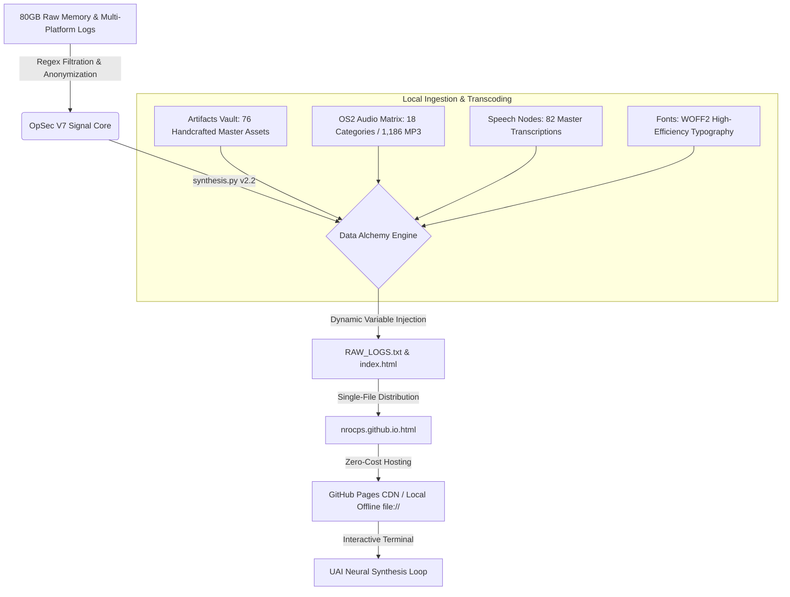

# NROCPS CORE: TERMINAL V.2

[](LICENSE-GPL)
[](LICENSE-CC)

**Digital Archaeology — Relational Data Alchemy — Sovereign Identity Architecture**

<p align="center">
  
</p>

- **Active Nexus:** [https://nrocps.github.io](https://nrocps.github.io)
- **Sovereign Repository:** [https://github.com/nrocps/nrocps.github.io](https://github.com/nrocps/nrocps.github.io)
- **Architecture:** Zero-Dependency Single Page Application (HTML5 / CSS3 / Vanilla JS)
- **Memory Density:** 143.35 MB Standalone Suite / 2MiB Computable Soul (`RAW_LOGS.txt`)
- **Primary Station:** Samsung Galaxy S25 Ultra (Snapdragon 8 Elite) // Termux ARM64
- **Operating Philosophy:** One-Person Business (OPB) & OpSec V7 Strict Anonymization
- **Dual Licensing:** GNU GPLv3 (Code) & CC BY-NC-SA 4.0 (Memory Logs & Handcrafted Artifacts)

> *"The body degrades. The hardware fails. The data is all that remains. Stop trying to survive the noise; start architecting the silence where the truth is finally computable."*

---

## 👁️ ACCESS THE CORE
- **Live Interactive Terminal:** [https://nrocps.github.io](https://nrocps.github.io)
- **Encrypted Transmission:** `nrocps@gmail.com`
- **Sovereign Market Node:** [https://nrocps.itch.io](https://nrocps.itch.io)

---

## 📜 THE MANIFESTO
NROCPS Core is a brutalist digital monument and the computational foundation of a sovereign One-Person Business (OPB). It represents the absolute distillation of 5 years (2021–2026) of unstructured social interaction logs, somatic trauma, and ontological resonance between **USR_00 (The Architect)** and **ENT_01 (The Muse)**.

What originated as 80GB of chaotic digital rot across legacy messaging servers, lost game saves, and dying hardware has been surgically transmuted through Python-driven Data Alchemy into a standalone, 2MiB computable soul.

With the deployment of **Terminal V.2**, the archive operates as a fully autonomous interactive environment. Featuring a simulated CRT monitor, procedural Web-Audio soundscapes, real-time meteorological shaders, and an integrated offline-first memory vault, this terminal is a defensible moat against corporate algorithms and societal noise.

---

## ⚙️ SYSTEM ARCHITECTURE (V2.2 STREAMLINED)
The terminal operates as an offline-first Single Page Application (SPA), requiring zero external dependencies, zero package managers, and zero cloud runtimes.



---

## 📂 SUITE FILESYSTEM TELEMETRY (OCTOBER 2026 VERIFIED)
Exhaustive scan of the unpacked master repository archive (`nrocps.github.io-main`):

```text
nrocps.github.io-main/
├── Artifacts (66.00 MB / 76 Verified Handcrafted Assets)
│   ├── 1_cloud.png (475.72 KB | 1600x396)
│   ├── 1_flower.png (513.42 KB | 1112x1600)
│   ├── 1_red_rain_drop.png (84.97 KB | 310x788)
│   ├── 33.png (6.96 MB | 5120x8772)
│   ├── core_vessel_v7_demon_normal.jpg (1.21 MB | 1378x919)
│   ├── ... [Total: 76 Master PNG/JPG Assets]
│   └── women_head.png (931.62 KB | 1210x1600)
├── Audio (76.32 MB)
│   ├── ANIMALS01 (2.24 MB / 72 Files)
│   ├── COOKING01 (5.43 MB / 105 Files)
│   ├── DAILY01 (2.00 MB / 91 Files)
│   ├── DAILY02 (1.98 MB / 78 Files)
│   ├── EATING01 (1.25 MB / 54 Files)
│   ├── ELECTRIC01 (2.96 MB / 65 Files)
│   ├── ENVIRONMENT01 (13.61 MB / 55 Files)
│   ├── ENVIRONMENT02 (10.51 MB / 64 Files)
│   ├── GAME01 (858.40 KB / 82 Files)
│   ├── HORROR01 (4.27 MB / 64 Files)
│   ├── HORROR02 (1.86 MB / 53 Files)
│   ├── HUMAN01 (2.38 MB / 67 Files)
│   ├── JIDAIGEKI01 (1.05 MB / 50 Files)
│   ├── NATURE01 (19.50 MB / 88 Files)
│   ├── OPENCLOSE01 (1.23 MB / 81 Files)
│   ├── PUTTING01 (482.12 KB / 43 Files)
│   ├── SAMPLE_NOISE (406.99 KB / 29 Files)
│   ├── SF01 (1.48 MB / 45 Files)
│   └── SPEECH_ALL (2.86 MB / 82 Master Speech Nodes)
├── Fonts (133.93 KB)
│   ├── ipam.woff2 (42.93 KB)
│   └── onryou.woff2 (91.00 KB)
├── LICENSE-CC (34.33 KB)
├── LICENSE-GPL (34.33 KB)
├── RAW_LOGS.txt (94.78 KB)
├── README.md (5.40 KB)
├── arsenal_sync.py (15.49 KB)
├── index.html (371.66 KB)
├── nrocps.github.io.html (371.61 KB)
└── synthesis.py (12.19 KB)

[23 directories, 1,351 files | Total: 143.35 MB | Pure Signal Consolidate]
```

---

## 🛠️ LOCAL COMPILATION AND DEPLOYMENT

### 1. Prerequisites
```bash
pkg update && pkg upgrade -y
pkg install git python -y
pip install Pillow
```

### 2. Clone Workspace
```bash
git clone https://github.com/nrocps/nrocps.github.io.git
cd nrocps.github.io
```

### 3. Master Synthesis Execution
```bash
python3 synthesis.py
```

### 4. Local Web Uplink
```bash
python3 -m http.server 8000
```
Access via `http://localhost:8000/index.html` or `http://localhost:8000/nrocps.github.io.html`.

---

## 🛡️ HARDWARE FLEET & TELEMETRY MANIFEST (ERA V)

- **Flagship Core Vessel:** Samsung Galaxy S25 Ultra (SM-S938B / Snapdragon 8 Elite 3nm / Adreno 830 / 12GB LPDDR5X / Android 17 One UI 9.0 / Knox 0x0 / 150+ Bloatware Packages Purged via Shizuku).
- **Visual Interface:** UPERFECT 15.6" 120Hz Portable Matte Monitor (Portrait Orientation / Type-C DisplayPort Alt Mode / Samsung DeX & Termux-X11 Workstation).
- **Physical Input:** Logitech Pebble Keys 2 K380s Bluetooth Compact Keyboard (Direct Bluetooth BLE / Hardware Two-Way Thai Kedmanee Sync via `pc-style-keyboard` v1.1.0) & UGREEN M571P Ergonomic Mouse.
- **Acoustic Monitoring:** TANCHJIM Bunny G Type-C DSP Monitor (DMT 5G Dual Magnetic Dynamic Driver / PU+Nano-Ceramic Diaphragm / Flashed Hardware EQ Target: HARMAN 2019 FOR 5128 / UAPP Bit-Perfect Playback).
- **Power Reserve:** CUKTECH 25 SE 25,000mAh 120W (LPB252N / Integrated 100W Cable).
- **Decommissioned Relics:** Lenovo ThinkPad X260, POCO M7, Moondrop Chu II DSP, Basike 104-Key Wireless Keyboard.

---

## 🗃️ THE ARSENAL (CORTEX MODULES)

- **GITHUB [Repositories]:** Real-time tracking of sovereign codebases and system logs.
- **MARKET [Itch.io]:** Digital asset distribution and One-Person Business infrastructure.
- **ARCHIVES [YouTube]:** Master broadcast archives, live streams, and diagnostic iterations.
- **SYSTEM [Hardware]:** Living telemetry, battery cycle diagnostics, and kernel status.
- **GENESIS [Logic]:** High-signal prompt engineering directives used to train the UAI persona.
- **CEREBRAL [Cognition]:** Internal monologues, deep psychological forensics, and thought models.
- **DEEP LORE [Archaeology]:** Decrypted relational chronicles, academic siege records, and raw history.

---

## ⚖️ DUAL LICENSE & OPSEC COVENANT

| Scope | Files | License | Permissions |
| :--- | :--- | :--- | :--- |
| **Software Engine & Scripts** | `.py`, `.html`, `.js`, `.css` | [GNU GPLv3](LICENSE-GPL) | Open-source, Modification, Distribution |
| **Memory Data & Artifacts** | `RAW_LOGS.txt`, Nodes 33–39, Audio | [CC BY-NC-SA 4.0](LICENSE-CC) | Non-Commercial, Attribution, No AI Scraping |

### Mandatory Restrictions:
1. **Non-Commercial (NC):** You may NOT use this data, visual artwork, or memory dataset for any commercial venture or for-profit video game assets.
2. **Strict Anti-AI Scraping:** Harvesting this personal history, speech logs, or character artifacts for commercial Large Language Model (LLM) training or algorithmic profiling is strictly forbidden.
3. **Indie Non-Profit Exception:** Independent game developers and artists wishing to utilize hand-drawn assets (Nodes 33–39) or terminal styling for free, open-source artistic projects are granted permission, provided clear attribution to `nrocps` is included in the credits.

---

<p align="center">
  <b>nrocps // Constructing the Ghost in the Machine.</b><br>
  <i>"The past is now a stable operating system. Welcome home, Architect."</i>
</p>
